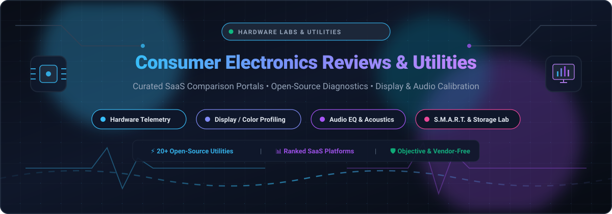

# Awesome Consumer Electronics Reviews & Hardware Utilities

**Curated Directory of SaaS Comparison Platforms, Objective Benchmarking Engines & Open-Source Hardware Diagnostics**

*Comprehensive resources for objective lab testing, display ICC profiling, acoustics & audio headphone EQ, thermal/voltage telemetry, NVMe/SSD S.M.A.R.T. health, and device debloating.*

---

## Table of Contents

- [Sector Overview & Market Dynamics](#sector-overview--market-dynamics)
- [SaaS & Hosted Comparison Platforms](#saas--hosted-comparison-platforms)
- [Open-Source GitHub Projects](#open-source-github-projects)
- [Recommended Hardware Stack Combinations](#recommended-hardware-stack-combinations)
- [How to Contribute](#how-to-contribute)
- [Support & Share](#support--share)
- [Disclaimer](#disclaimer)

---

## Sector Overview & Market Dynamics

The global consumer electronics testing, inspection, and certification (TIC) market represents approximately **$92 billion to $97 billion** within a total broader electronics ecosystem exceeding **$1.3 trillion**. 

The sector exhibits a **moderately fragmented** structure: traditional high-traffic editorial publications and legacy media holding companies (such as The New York Times Company, Future plc, and Ziff Davis) dominate broad consumer purchase intent through search affiliate funnels, whereas rigorous, scientific testing labs (such as RTINGS and Consumer Reports) and vertical technical databases (such as Notebookcheck and GSMArena) maintain resilient, high-moat niches characterized by specialized laboratory instrumentation, high domain authority, and strong direct-subscriber loyalty.

---

## SaaS & Hosted Comparison Platforms

The table below compiles leading consumer electronics review platforms and spec comparison services. In accordance with transparent evaluations, platforms are sorted in descending order by parent company scale (market capitalization, annual revenue, or corporate valuation).

| Platform | Corporate Scale (Market Cap / Valuation / Revenue) | Category Focus | Pricing (Starting Paid Tier) | Free Tier / Trial Limits | Key Features |
|:---|:---|:---|:---|:---|:---|
| **[Wirecutter (The New York Times)](https://www.nytimes.com/wirecutter/)** | **~$11.4B Market Cap** *(NYSE: NYT)* | Consumer tech, home office & lifestyle hardware | **$5.00 every 4 weeks** (or $40.00/year standalone) | **Metered free access** (limited to 2–5 free article views per month without subscription) | Exhaustive editorial long-term testing, hands-on lab trials, and vetted buyer guides. |
| **[TechRadar Pro](https://www.techradar.com/pro)** | **~$350M Market Cap / £739M Revenue** *(Future plc - LSE: FUTR)* | Enterprise IT hardware, workstations, networking & business laptops | **$4.99/month** (ad-free subscriber tier) | **Free ad-supported web access** with unlimited reading across all publicly indexed hardware guides | Dedicated B2B/enterprise workstation hardware evaluation, cloud networking tests, and productivity bench comparisons. |
| **[Tom's Guide & Tom's Hardware](https://www.tomsguide.com)** | **~$350M Market Cap / £739M Revenue** *(Future plc - LSE: FUTR)* | PC components, desktop GPUs/CPUs, monitors & consumer peripherals | **$4.99/month** (ad-free digital reader tier) | **Free ad-supported web access** (unlimited benchmark charts, editorial tear-downs, and buyer articles) | Proprietary lab frame-rate tests, battery endurance benches, and custom GPU/CPU hierarchy charts. |
| **[Consumer Reports Digital](https://www.consumerreports.org)** | **~$267.2M Annual Revenue** *(Nonprofit Form 990 / $474M Total Assets)* | Independent laboratory testing, consumer appliance safety & electronics reliability | **$39.00/year** (Standard Digital) or **$64.00/year** (All Access) | **Free tier limited to non-scored articles** (ratings, lab reliability scores, and brand defect surveys locked behind paywall; 0-day free trial) | 100% unbiased lab tests purchasing all consumer test samples anonymously without affiliate bias. |
| **[CNET Reviews](https://www.cnet.com/tech/)** | **~$100M Valuation** *(Acquired by Ziff Davis - NASDAQ: ZD)* | Smart home, smartphones, TVs, computing & wearable tech | **$4.99/month** (via Ziff Davis tech pass / ad-light digital features) | **Free ad-supported web access** (unlimited access to reviews, specs, buying recommendations, and video tests) | Massive consumer technology catalog, video tear-downs, and real-world durability evaluations. |
| **[Versus](https://versus.com)** | **~$20M–$40M Valuation** *(Versus EU)* | Algorithmic side-by-side spec comparison engine | **$0.00** (100% Free platform supported by affiliate partnerships) | **Completely free forever** with no query quotas, full spec metric access, and comparison matrixes | Side-by-side specs comparison across smartphones, GPUs, mirrorless cameras, and audio gear across 100+ data points. |
| **[GSMArena & SpecCheck](https://www.gsmarena.com)** | **~$15M–$30M Valuation / ~€5M–€10M Revenue** *(Privately held)* | Mobile smartphones, tablets, smartwatches & cellular radios | **$0.00** (100% Free platform supported by display ads & B2B data licensing) | **Completely free forever** (unlimited device spec searches, interactive camera comparison tools, and battery life lab results) | Standardized studio test scenes for phone cameras, loudspeaker loudness curves, and sunlight screen contrast measurements. |
| **[RTINGS.com](https://www.rtings.com)** | **~$7.3M Annual Revenue** *(Bootstrapped & Privately held)* | Objective hardware lab measurements (Monitors, TVs, Headphones, Mice, Laptops) | **$10.00/month** or **$45.00/year** (RTINGS Insider) | **Free tier limited to basic review scores** (early access reviews locked for 7 days; side-by-side comparison tool restricted to 3 active comparisons per day) | Standardized robotic testing benches, Delta-E colorimeter measurements, audio frequency curves, and monitor input lag timings. |
| **[Notebookcheck](https://www.notebookcheck.net)** | **~$5.0M–$8.0M Annual Revenue** *(Notebookcheck Publishing GmbH)* | Laptop internals, mobile thermals, PWM flicker, display calibration & mobile GPUs | **$1.99/month** (or €1.80/month for ad-free reader subscription) | **Free ad-supported access** (unlimited access to complete review benchmarks, thermal IR photos, and PWM flicker charts) | Exhaustive thermal dissipation thermal imaging, oscilloscope display PWM testing, and multi-game mobile benchmark archives. |
| **[NanoReview](https://nanoreview.net)** | **~$1.5M–$3.0M Valuation** *(Privately held)* | Mobile SoC benchmarks, smartphone specs, CPU/GPU synthetics & laptop tests | **$0.00** (100% Free platform supported by programmatic ads) | **Completely free forever** (unlimited access to Geekbench/AnTuTu score comparisons, gaming test matrices, and battery endurance indexes) | Direct side-by-side silicon comparisons (Snapdragon vs Apple Silicon vs Dimensity vs Intel/AMD) with normalized benchmark indexes. |

---

## Open-Source GitHub Projects

Discover premier open-source utilities and diagnostic suites for testing, optimizing, benchmarking, and maintaining consumer electronics. Ranked in descending order by GitHub stargazer count.

| Project & Repo Link | GitHub Stars | Primary Domain / Focus | Key Capabilities & Reviewer Utility |
|:---|:---:|:---|:---|
| **[aristocratos/btop](https://github.com/aristocratos/btop)** |  | Terminal Resource & Hardware Monitor | Modern C++ TUI monitoring real-time CPU core frequencies, memory pressure, I/O rates, and GPU thermals across NVIDIA, AMD, and Intel hardware. |
| **[nicolargo/glances](https://github.com/nicolargo/glances)** |  | Cross-Platform System Telemetry & Web Dashboard | Python-based system telemetry engine with built-in REST API and web UI for tracking hardware sensors, storage load, and power utilization. |
| **[qmk/qmk_firmware](https://github.com/qmk/qmk_firmware)** |  | Peripheral Firmware & Input Latency | Open-source keyboard firmware enabling ultra-low input latency tuning, matrix debouncing adjustments, and custom hardware layers. |
| **[jaakkopasanen/AutoEq](https://github.com/jaakkopasanen/AutoEq)** |  | Headphone Acoustic Calibration & EQ | Standardized frequency response database with automated parametric EQ profiles for 5,000+ headphones based on Harman target curves. |
| **[Syllo/nvtop](https://github.com/Syllo/nvtop)** |  | Multi-Vendor GPU Task & Thermal Monitor | Interactive top-like GPU monitor supporting AMD (amdgpu), NVIDIA, Intel (i915/Xe), Apple Silicon (M-series), and Qualcomm Adreno GPUs. |
| **[Universal-Debloater-Alliance/universal-android-debloater-next-generation](https://github.com/Universal-Debloater-Alliance/universal-android-debloater-next-generation)** |  | Smartphone Bloatware & Telemetry Removal | Rust GUI utilizing ADB to remove OEM bloatware, tracking packages, and carrier telemetry on Samsung, Xiaomi, Pixel, and OnePlus devices without root. |
| **[LibreHardwareMonitor/LibreHardwareMonitor](https://github.com/LibreHardwareMonitor/LibreHardwareMonitor)** |  | Windows Hardware Telemetry & Sensor GUI | Comprehensive Windows sensor inspection reading VRM voltages, core clocks, package wattage, fan curves, and NVMe health via S.M.A.R.T. |
| **[xanderfrangos/twinkle-tray](https://github.com/xanderfrangos/twinkle-tray)** |  | Windows Display DDC/CI Brightness Control | System tray utility managing multi-monitor hardware brightness and contrast using DDC/CI communication over DisplayPort and HDMI. |
| **[flightlessmango/MangoHud](https://github.com/flightlessmango/MangoHud)** |  | Graphics Overlay & Frame-Time Benchmark | Vulkan/OpenGL HUD overlay measuring frame times, 1% / 0.1% lows, GPU/CPU power consumption, and thermal acoustic throttles. |
| **[htop-dev/htop](https://github.com/htop-dev/htop)** |  | Unix Process & Sensor Viewer | Interactive ncurses terminal monitor displaying CPU core load distribution, hardware interrupts, and memory footprint. |
| **[AdnanHodzic/auto-cpufreq](https://github.com/AdnanHodzic/auto-cpufreq)** |  | CPU Governor & Laptop Battery Optimization | Automatic Linux CPU speed and power optimizer dynamically adjusting scaling governors to improve battery life and thermals. |
| **[openhardwaremonitor/openhardwaremonitor](https://github.com/openhardwaremonitor/openhardwaremonitor)** |  | Hardware Sensor Telemetry Suite | Lightweight open-source Windows hardware monitor displaying clock speeds, fan RPMs, and CPU/GPU temperatures with WMI support. |
| **[axboe/fio](https://github.com/axboe/fio)** |  | NVMe / SSD / Storage I/O Benchmark Engine | The gold-standard flexible I/O benchmark engine for measuring random IOPS, sustained write bandwidth, and latency distributions. |
| **[emoacht/Monitorian](https://github.com/emoacht/Monitorian)** |  | Multi-Monitor DDC/CI Luminescence Utility | Desktop Windows tool to adjust the brightness and contrast of multiple external monitors individually or synchronously via DDC/CI. |
| **[CalcProgrammer1/OpenRGB](https://github.com/CalcProgrammer1/OpenRGB)** |  | Vendor-Neutral Peripheral & RGB Control | Lightweight cross-platform hardware lighting controller replacing proprietary, telemetry-heavy vendor software suites. |
| **[linrunner/TLP](https://github.com/linrunner/TLP)** |  | Advanced Linux Laptop Power Management | Automated power management tool optimizing battery wear levels, charge thresholds, and PCIe power states for laptops. |
| **[phoronix-test-suite/phoronix-test-suite](https://github.com/phoronix-test-suite/phoronix-test-suite)** |  | Automated Hardware Benchmark & Profiler | Comprehensive multi-platform benchmarking suite for automated, reproducible execution of CPU, GPU, memory, and kernel tests. |
| **[TheTumultuousUnicornOfDarkness/CPU-X](https://github.com/TheTumultuousUnicornOfDarkness/CPU-X)** |  | Hardware Information & CPU Inspection | Open-source CPU-Z alternative for Linux and BSD systems detailing CPU architectures, caches, motherboards, RAM, and GPU clocks. |
| **[memtest86plus/memtest86plus](https://github.com/memtest86plus/memtest86plus)** |  | Standalone Memory Fault Diagnostics | Bootable memory testing diagnostic tool operating independently of any OS to detect DDR4/DDR5 RAM hardware defects. |
| **[JonMagon/KDiskMark](https://github.com/JonMagon/KDiskMark)** |  | Storage Benchmark GUI (CrystalDiskMark Alternative) | Clean Qt GUI for `fio` benchmarking sequential and random read/write throughput on SSDs, NVMe drives, and flash storage. |
| **[eoyilmaz/displaycal-py3](https://github.com/eoyilmaz/displaycal-py3)** |  | Display Colorimeter Calibration & ICC Profiling | Modernized Python 3 GUI for ArgyllCMS providing advanced color calibration, Delta-E verification, and ICC profiles for monitors. |
| **[smartmontools/smartmontools](https://github.com/smartmontools/smartmontools)** |  | Storage Health & S.M.A.R.T. Telemetry | Standard `smartctl` / `smartd` utilities monitoring drive health, wear indicators, reallocated sectors, and predictive failures. |
| **[rockowitz/ddcutil](https://github.com/rockowitz/ddcutil)** |  | Linux DDC/CI Monitor Control Command-Line | Programmatic control of monitor hardware parameters (brightness, contrast, color presets, input select) over I2C bus. |
| **[rfaile313/samsucks](https://github.com/rfaile313/samsucks)** |  | Smart TV Bloatware Mitigation & Client Utility | Consumer electronics utility providing a lightweight, telemetry-free media client alternative for Samsung Smart TVs. |

---

## Recommended Hardware Stack Combinations

- **Full System Telemetry & Diagnostics**: Deploy **LibreHardwareMonitor** (Windows) or **CPU-X + btop / nvtop** (Linux) alongside **smartmontools** for proactive hardware monitoring.
- **Display & Colorimetric Calibration**: Pair **DisplayCAL** with **twinkle-tray** or **Monitorian** for precision hardware DDC/CI brightness control and calibrated ICC color accuracy.
- **Audio & Acoustic Equalization**: Utilize **AutoEq** to apply Harman curve acoustic compensations across consumer headphones and IEMs.
- **Storage Benchmarking & Validation**: Combine **KDiskMark** or **fio** with **smartmontools** to evaluate read/write throughput and monitor controller temperatures.
- **Mobile Debloating & Privacy**: Run **Universal Android Debloater (Next Generation)** to disable manufacturer telemetry without root.

---

## How to Contribute

We welcome community contributions! To suggest new tools or update existing entries:

1. **Fork the repository** to your personal GitHub account.
2. **Add or modify entries** in `README.md` maintaining the established tabular schema.
   - For SaaS tools: include verified pricing and specific free tier/trial limits.
   - For Open-Source repositories: include repository links and official star counts.
3. **Submit a Pull Request** with a concise description of the hardware utility or comparison service.

---

## Support & Share

If you find this curated collection useful for your hardware testing workflow, benchmark lab, or consumer tech purchases:

- ⭐ **Star this repository** to improve discoverability on GitHub.
- 📢 **Share with fellow enthusiasts** on Reddit, Twitter/X, and tech forums.
- ☕ **Support Open-Source Maintenance** via GitHub Sponsors or community contributions.

---

## Disclaimer

This repository is an independently curated educational resource and does not constitute formal endorsement of any listed software, platform, or hardware manufacturer. Benchmark metrics and synthetic scores provide baseline indications, but real-world performance, thermals, and battery longevity vary across ambient temperatures and firmware configurations. When utilizing ADB debloaters or low-level hardware flashing tools, always verify device compatibility and maintain system backups.
